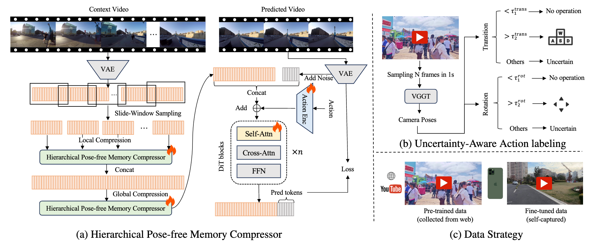

# Agar Infinite World

Jason Gilles' local world-model laboratory, built on MeiGen-AI's Infinite-World research code. Agar adds a browser app, CLI, chunk controls, previews, checkpoint preflight, experiment snapshots, and an experimental cumulative drift monitor. The pretrained model and hierarchical memory architecture are upstream work.

## Highlights



- Prompt + starting image + movement/camera controls.
- 13 chunks target **1,041 frames**: one starting frame and 80 new frames per chunk.
- Watch completed chunks, update actions for the next chunk, or stop after the current chunk.
- Save videos, inputs, configuration snapshots, and telemetry in unique run folders.
- Optional Gilles–Dini inspired appearance budget, disabled by default. See [research notes](docs/GILLES_DINI.md).

**Validation:** 12 CPU adapter tests pass. GPU inference, checkpoint compatibility, long-horizon quality, and memory requirements remain unvalidated here. Generation is chunk based. A starting image is required; the campus example is included by default. Prompt-only generation is not supported by this inference path.

## Install: Linux or Windows with WSL2

Use an NVIDIA GPU and CUDA driver. Native Windows inference is untested; upstream FlashAttention/decord dependencies favor Linux/WSL2. No minimum VRAM guarantee is available. Full video history is retained and re-encoded each chunk, so RAM, VRAM demand and latency grow over time.

```bash
git clone https://github.com/TveJason/Agar-Infinite-World-Scaling-Interactive-World-Models.git
cd Agar-Infinite-World-Scaling-Interactive-World-Models
conda create -n agar-world python=3.10 -y
conda activate agar-world
python -m pip install torch==2.6.0 torchvision==0.21.0 --index-url https://download.pytorch.org/whl/cu124
python -m pip install packaging ninja
python -m pip install flash_attn==2.7.4.post1 --no-build-isolation
python -m pip install -r requirements.txt
python -m pip install -r requirements-demo.txt
```

FlashAttention may need a matching CUDA toolkit/compiler. Upstream dependency pins are retained; installation has not been validated as a complete GPU environment.

## Checkpoints and launch

Download from [MeiGen-AI/Infinite-World](https://huggingface.co/MeiGen-AI/Infinite-World). Edit `configs/infworld_config.yaml` for different locations. Relative paths resolve from the repository root. Use the fine-tuned Infinite-World DiT, not stock Wan weights.

| Config key | Default path |
| --- | --- |
| `checkpoint_path` | `checkpoints/infinite_world_model.ckpt` |
| `vae_cfg.vae_pth` | `checkpoints/models/Wan2.1_VAE.pth` |
| `text_encoder_cfg.checkpoint_path` | `checkpoints/models/models_t5_umt5-xxl-enc-bf16.pth` |
| `text_encoder_cfg.tokenizer_path` | `checkpoints/models/google/umt5-xxl/` |

```bash
python agar_cli.py --check
python local_app.py
```

Open **http://127.0.0.1:7860**, or the URL printed by Gradio. Click Generate world with the default campus scene. Start with **1 chunk** to check GPU compatibility, then try 13. The app binds to localhost with public sharing disabled.

CLI examples:

```bash
python agar_cli.py --chunks 1
python agar_cli.py --chunks 13 --prompt "A quiet campus walkway in morning light" --move "go forward" --view "no-op"
```

Options include `--image`, `--config`, `--seed`, `--steps`, and optional `--budget`. Preflight checks presence only, not weight integrity. The adapter requires `validation_data.num_frames=81`.

## Outputs and control behavior

Each run writes `outputs/<run-id>/`. `chunk-0001.mp4` etc. are separate previews including the conditioning frame. The final video under `infworld-ckpt.../` joins chunks without duplicate boundaries. Inputs and settings are in `request.json`, `model.yaml`, and `actions.json`; progress and optional drift are in `telemetry.json`. Browser runs also save `console.log`.

`control.json` is reread at each chunk boundary. A changed action applies to all subsequent chunks until changed again. Place an empty `STOP` file inside the run folder to stop CLI inference after the current chunk. Stop preserves completed previews and assembles the video. Failed runs may have previews without a final assembled video. Mid-chunk control and restart-from-latent recovery are not implemented. Seed reproducibility on GPU is best effort.

## CPU checks

```bash
python -m pip install -r requirements-light.txt
python -m pytest tests -q
```

These tests require no checkpoints or GPU and do not demonstrate generation quality. The paper's 1,000+ frame result belongs to upstream; Agar's 1,041-frame setting is an unvalidated target.

## Provenance

Source: [MeiGen-AI/Infinite-World](https://github.com/MeiGen-AI/Infinite-World), revision `1e8fc49ba7dc0f928c966c49c31fda9394c045d3`. Original credits and citation are retained in [UPSTREAM_README.md](UPSTREAM_README.md). Upstream declares MIT in its README, but its referenced LICENSE file is absent at this revision; missing copyright text has not been invented. Check model-weight terms separately. See [PROVENANCE.md](PROVENANCE.md).
